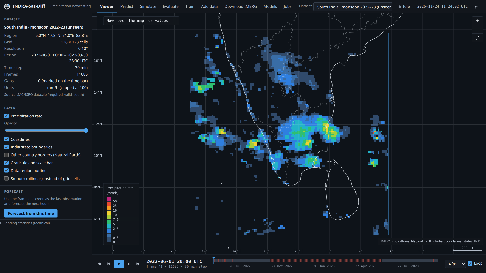
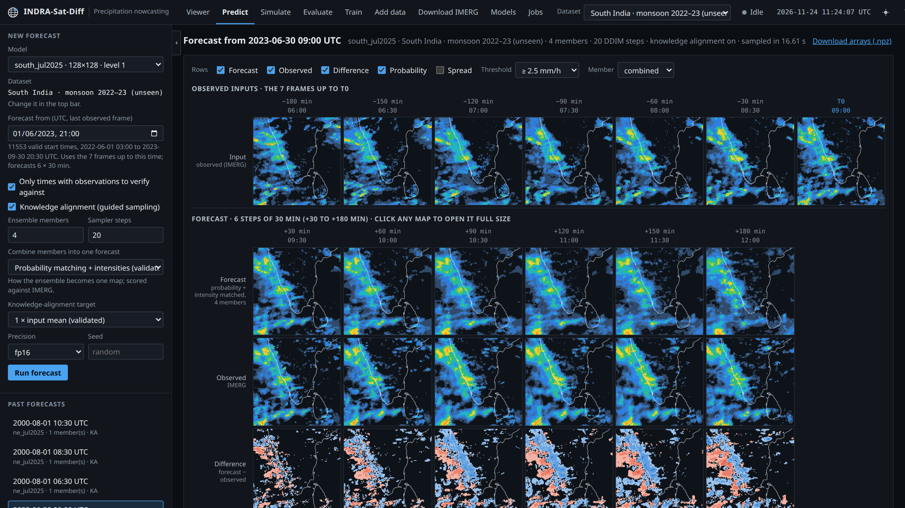
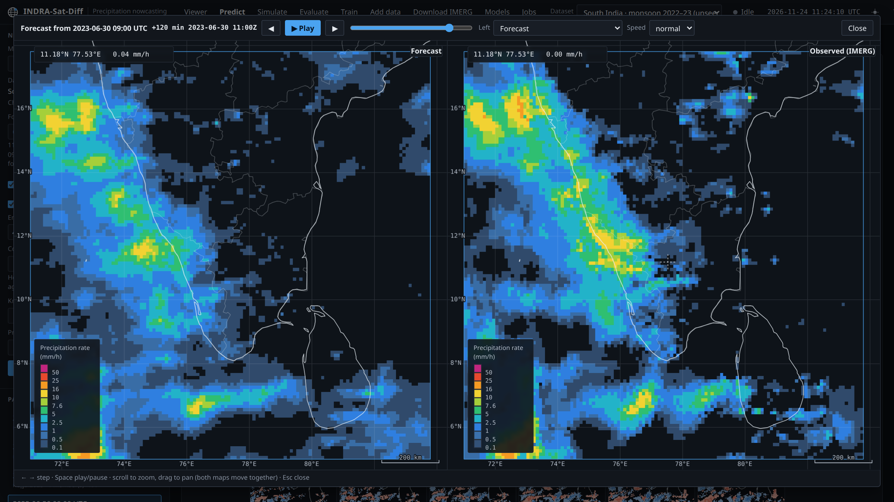
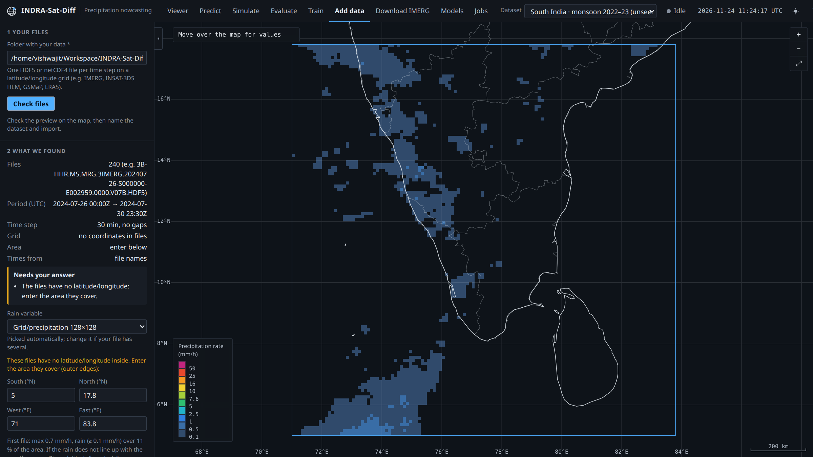
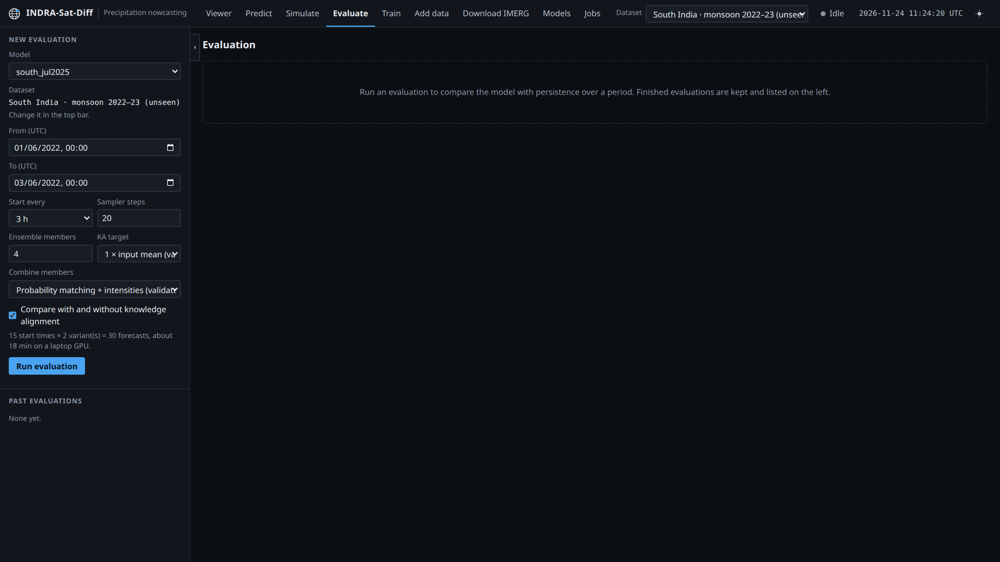
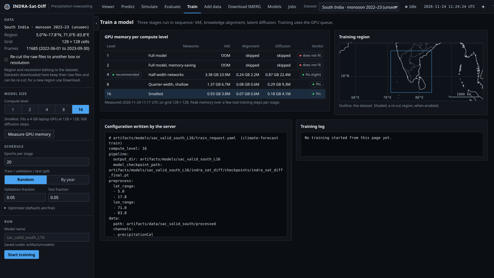
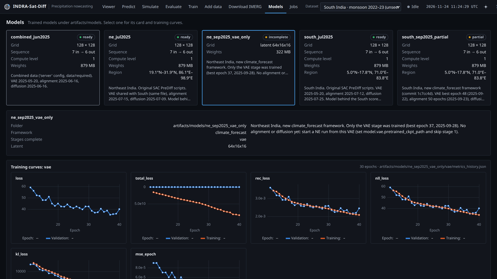
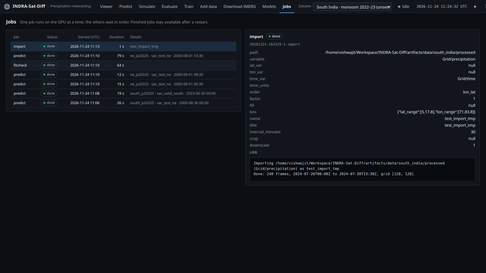

# INDRA-Sat-Diff

Precipitation nowcasting from satellite rainfall with a latent diffusion model.
Given 7 half-hourly frames (3.5 h), the model samples the next 6 frames (3 h).
It was developed for the Indian monsoon on NASA GPM IMERG data during an internship at the
Space Applications Centre (SAC), ISRO, and is presented at IEEE InGARSS 2026
(paper 1571324784, poster session POS-0401P, 4 December 2026).

The method follows PreDiff (Gao et al., NeurIPS 2023):

1. a VAE compresses each 128 × 128 frame to a 64 × 16 × 16 latent;
2. an Earthformer-style cuboid-attention U-Net learns to denoise the 6-frame latent forecast,
   conditioned on the 7 context latents;
3. Knowledge Alignment (KA) adds the gradient of a small learned network (predicting the
   mean future intensity) to each sampling step, steering samples without retraining.

## Results

On unseen June–September 2023 IMERG data, with 4 ensemble members combined into one forecast and the
combination and KA settings chosen per region on 2022 (stored in each model's `inference` config):

- **Southern India** (KA 1×, probability matching with intensities): CSI at ≥ 1 mm/h beats persistence at every lead time (significant to +150 min)
  and a 50-member PySTEPS at +30–60 min; also ahead on heavy rain (≥ 7.6 mm/h) at +60–150 min;
  lowest MAE/RMSE of the three.
- **Northeast India** (no KA, probability threshold): calibration improves the model by +0.04–0.07 CSI but it stays below persistence and
  PySTEPS; its VAE is the South VAE, so a Northeast VAE is the first fix.

The single-sample protocol of the original evaluation (KA target 2×) scores below persistence in both
regions. Full tables, protocol and limitations: [`docs/RESULTS.md`](docs/RESULTS.md); plans:
[`docs/ROADMAP.md`](docs/ROADMAP.md).

## Install

Requires Python 3.10+ and, for training, an NVIDIA GPU.

```bash
git clone https://github.com/vishwajitsarnobat/INDRA-Sat-Diff
cd INDRA-Sat-Diff
uv venv && uv pip install -e .
uv pip install -e ".[app]"                                   # web app
# PySTEPS baseline (tools/run_pysteps.py) needs a separate Python 3.11 env, as pysteps is source-only:
uv venv --python 3.11 .venv-steps && uv pip install -p .venv-steps/bin/python pysteps opencv-python-headless h5py
```

## Use

Everything is driven by one YAML file that overrides `climate_forecast/configs/train.yaml`.
Example configs are in `climate_forecast/examples/` (full model, low-end laptop, and
ready-made South / Northeast India regions in `examples/regions/`).

```bash
# data: IMERG half-hourly, cut to your box on the server side (needs an Earthdata login in ~/.netrc)
climate-forecast download   --config my_region.yaml --start 2023-12-01T00:00 --end 2023-12-06T23:30
climate-forecast preprocess --config my_region.yaml

# training: check what fits your GPU, then train all three stages
climate-forecast fit-check --config my_region.yaml
climate-forecast train     --config my_region.yaml

# forecast from the frame at T0 (the last of the 7 inputs); defaults come from the model's `inference` settings
climate-forecast forecast --config my_region.yaml --input path/to/T0_file.HDF5 \
    [--ensemble 4 --steps 20 --postprocess pmi --ka-multiplier 1 --no-alignment --precision fp16]
```

### Web app (no YAML needed)

```bash
.venv/bin/python -m app        # then open http://127.0.0.1:8765
```

| Page | What you do there |
|---|---|
| Viewer | browse IMERG rain maps of any dataset, animate, read values, jump to a forecast |
| Predict | pick a model and start time; get the ensemble forecast, probability and spread maps, and its skill against observations and persistence; open any map full size, side by side with the observation, and play it |
| Simulate | replay a storm with forecasts issued every 1–3 h |
| Evaluate | score a model against persistence over any period (CSV export) |
| Add data | point to a folder of your own files (INSAT-3DS HEM, GSMaP, IMERG, ERA5, ...); the app detects variables, grid, times and units, shows a preview, and imports it |
| Download IMERG | draw a region, pick dates and IMERG product; the app downloads and preprocesses it |
| Train | choose dataset, model size (with a GPU-memory check) and split; the app writes the config and trains |
| Models / Jobs | model registry with training curves and *Resume training*; queue with live logs |

Step-by-step instructions for scientists: **[`docs/APP_GUIDE.md`](docs/APP_GUIDE.md)**.

### Compute levels

`compute_level: 1 | 2 | 4 | 8 | 16` scales the networks so training fits smaller GPUs; values you
set explicitly still win. Peak training memory at 128 × 128 on a 4 GB RTX 2050:

| level | change | peak memory |
|---|---|---|
| 1 | full model (as trained at SAC) | out of memory for all three stages; resuming only the diffusion stage fits at ~3.5 GB (EMA in RAM, gradient checkpointing, micro-batch 1) |
| 2 | gradient checkpointing, micro-batch 1 | out of memory |
| 4 | half-width networks, 32-channel latent | 3.5 GB |
| 8 | quarter width, shallow, 16-channel latent | 1.4 GB |
| 16 | smallest, 8-channel latent | 0.9 GB |

Grid size is a data choice: use a smaller region or `preprocess.downscale_factor`. A model
trained on one grid can forecast on another; inputs and outputs are resampled.

### Data format

One HDF5/netCDF4 file per time step with a 2-D field, latitude, longitude and a time variable.
Variable names, coordinate order and the lat/lon box are set in the config. The time epoch is
read from the variable's CF `units` attribute (IMERG uses seconds since 1980-01-06).

## Repository layout

```
climate_forecast/   package: data, models, diffusion + KA, training stages, pipelines, CLI
app/                web app (FastAPI backend, static frontend, single-GPU job queue)
tools/              validation study, PySTEPS baseline, overnight runner
docs/               app guide, results, roadmap, InGARSS 2026 poster (sources, figures, Q&A), diagrams
artifacts/          not in git: models, data, cached forecasts, results, job logs, original SAC code
```

## Citation

V. Sarnobat, V. Yadav, A. Chhari, Y. Vaviya, "INDRA-Sat-Diff: High-Fidelity Generative
Precipitation Nowcasting for the Indian Monsoon Using a Satellite-Adapted Latent Diffusion
Model," IEEE India Geoscience and Remote Sensing Symposium (InGARSS), Hyderabad, 2026.

## Acknowledgements

Dr. Prashant Kumar (SAC, ISRO) for guidance; SAC, ISRO and Sardar Patel Institute of
Technology, Mumbai. Code adapted from PreDiff (Apache 2.0), Earthformer, Hugging Face
Diffusers, Stable Diffusion and OpenAI guided-diffusion.

## License

MIT, except files adapted from the projects above, which keep their original licenses.

## Screenshots

| | |
|---|---|
| **Viewer** — IMERG rain maps with time bar, layers and values on hover | **Predict** — inputs, ensemble forecast, observation, difference and probability |
|  |  |
| **Full-size forecast** — forecast next to the observation, linked cursor, playback | **Add data** — inspect your own files, answer only what is needed, preview, import |
|  |  |
| **Evaluate** — score a model against persistence over a period | **Train** — every setting from the UI, with a GPU-memory check |
|  |  |
| **Models** — registry, validated settings and training curves | **Jobs** — single-GPU queue with live logs |
|  |  |
